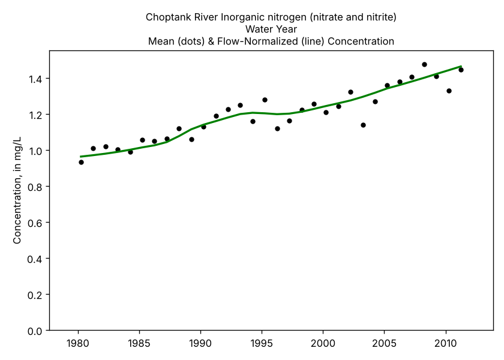
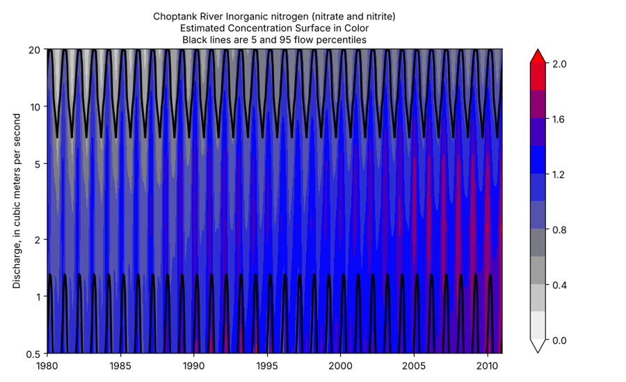

# PyEGRET

[](https://github.com/gopalam/PyEGRET/actions/workflows/tests.yml)

**River water-quality trends in Python: a translation of the USGS EGRET R
package and the WRTDS method.**

PyEGRET estimates how the concentration and load of a constituent in a river
(nitrate, phosphorus, chloride, sediment) have changed over decades, and
separates the change caused by the watershed from the change caused by wetter
or drier years. It does this with **WRTDS** (Weighted Regressions on Time,
Discharge, and Season; Hirsch and others, 2010), as implemented by the U.S.
Geological Survey in the R package
[EGRET](https://github.com/DOI-USGS/EGRET). PyEGRET follows EGRET function by
function and is checked against results that R EGRET itself produced.

> **Status: version 0.1.0, beta.** The WRTDS model, flow normalization
> (including generalized flow normalization), WRTDS-Kalman, the trend
> functions `run_pairs`, `run_groups` and `run_series`, and 24 of EGRET's plots
> are translated and validated. **Bootstrap confidence intervals and trend
> p-values (EGRETci) are not yet available**; until they are, use R's EGRETci
> for significance testing. PyEGRET is an independent project and is not a
> USGS product.

<p align="center">
  
  
</p>

## What it does

- **Fits the WRTDS model** to a daily discharge record and a set of
  water-quality samples, including censored ("less than") values, and
  estimates concentration and flux for every day.
- **Flow-normalizes** the results, removing the year-to-year noise of
  streamflow so the underlying trend is visible, either against the whole
  discharge record or, with generalized flow normalization, against a moving
  window that lets the flow distribution itself change.
- **Decomposes a change** between two years or two groups of years into the
  part due to the watershed (the concentration-discharge trend component,
  CQTC) and the part due to streamflow (QTC).
- **WRTDS-Kalman** daily estimates that use the serial correlation of the
  residuals, for the best estimate of what actually happened on each day.
- **Streamflow trends** without water-quality data: annual flow statistics
  and the Quantile-Kendall analysis.
- **EGRET's tables and plots**: annual results, change tables, concentration
  and flux histories, contour surfaces, residual diagnostics.

## Installing

PyEGRET needs Python 3.9 or later, with numpy, pandas, scipy and matplotlib.

**With pip**, straight from GitHub:

```
pip install "pyegret @ git+https://github.com/gopalam/PyEGRET"
pip install "pyegret[usgs] @ git+https://github.com/gopalam/PyEGRET"   # also the USGS data readers
```

**Without installing anything**: download or clone the repository and put
its folder on the Python path. PyEGRET is written to work this way.

```python
import sys
sys.path.insert(0, r"C:\path\to\PyEGRET")
import pyegret
```

See [docs/installation.md](docs/installation.md) for details.

## Quick start

```python
import pandas as pd
from pyegret import merge_report, model_estimation
from pyegret.data.read_user import read_user_daily, read_user_sample
from pyegret.analysis import table_results, run_pairs
import pyegret.plots as plots

# Two CSV files: date,discharge (in cfs, as in EGRET) and date,remark,value
daily = read_user_daily("daily.csv")
sample = read_user_sample("sample.csv")
info = pd.DataFrame([{"shortName": "My River", "paramShortName": "Nitrate"}])

elist = merge_report(info, daily, sample)    # the eList: a plain dict
elist = model_estimation(elist)              # fit WRTDS (about half a minute)

table_results(elist)                          # annual concentration and flux
fig, ax = plots.plot_conc_hist(elist)         # annual and flow-normalized history
pairs = run_pairs(elist, 1990, 2020, window_side=7)   # change, and its causes
```

The [tutorials](tutorials/) walk through a complete analysis, and through
preparing your own data, as Jupyter notebooks you can read on GitHub or run in
Google Colab. [docs/getting_started.md](docs/getting_started.md) explains the
eList, the data formats, units and censoring, and how to read data from USGS.

## Coming from R EGRET

Names are R's in snake_case (`modelEstimation` becomes `model_estimation`,
`windowSide` becomes `window_side`), arguments keep R's order and defaults,
unit codes (`qUnit`, `fluxUnit`) keep EGRET's numbering, and the columns of
`Daily`, `Sample` and `INFO` have exactly R's names. The eList is a plain
Python dict with R's element names, so `eList$Daily` becomes
`elist["Daily"]`. [docs/r_to_python.md](docs/r_to_python.md) maps every R
function to its Python counterpart.

## How closely it matches R

Checked against output R EGRET itself computed (files from EGRET's own
repository and vignettes; R is not needed to rerun the checks):

| what R ran | agreement |
|---|---|
| `modelEstimation` with current defaults (Potomac River, total phosphorus) | annual flow-normalized values within 0.004 %; daily median 0.02 % |
| `modelEstimation` on the Choptank River (older defaults) | 99.6 % of surface cells to 1e-4; flow-normalized change +35.5 % v. +35.5 % |
| `runPairs(1985, 2010, windowSide = 7)`, Choptank | within 0.05 %; total change +38.5 % v. R's +38.6 % |
| `runPairs` with a wall, a flow break and an April-August season | within 0.06 % |
| `runSeries`, 68-year Green River chloride record, wall and flow break | annual values median 1e-6, worst year 0.1 % |

The small differences come from the optimizer: SciPy's L-BFGS-B and R's
`survreg` settle a few decimals apart where the data constrain the
regression least. Details in [docs/validation.md](docs/validation.md).

## Documentation

- [Tutorials](tutorials/): a complete analysis, bringing in your own data, and
  downloading data from USGS
- [Installation](docs/installation.md)
- [Getting started](docs/getting_started.md): the eList, data, units,
  censoring, the period of analysis
- [R to Python function map](docs/r_to_python.md)
- [Validation against R](docs/validation.md)
- [Changelog](CHANGELOG.md) and [contributing](CONTRIBUTING.md)
- For the method itself, the EGRET user guide (Hirsch and De Cicco, 2015)
  remains the best reference: <https://doi.org/10.3133/tm4A10>

## Credits and how to cite

WRTDS and EGRET are the work of Robert M. Hirsch, Laura A. De Cicco, Jennifer
C. Murphy and colleagues at the U.S. Geological Survey; PyEGRET only
translates them. If you use PyEGRET, please cite the method and the R
package as well as PyEGRET (GitHub's "Cite this repository" button gives the
PyEGRET entry):

- Hirsch, R.M., Moyer, D.L., and Archfield, S.A., 2010, Weighted Regressions
  on Time, Discharge, and Season (WRTDS), with an application to Chesapeake
  Bay river inputs: JAWRA, v. 46, no. 5, p. 857-880.
  <https://doi.org/10.1111/j.1752-1688.2010.00482.x>
- Hirsch, R.M., and De Cicco, L.A., 2015, User guide to Exploration and
  Graphics for RivEr Trends (EGRET) and dataRetrieval: R packages for
  hydrologic data: USGS Techniques and Methods 4-A10.
  <https://doi.org/10.3133/tm4A10>
- Hirsch, R.M., De Cicco, L.A., and Murphy, J., 2025, Exploration and
  Graphics for RivEr Trends (EGRET), version 3.0.12.
  <https://doi.org/10.5066/P9CC9JEX>

Citations for generalized flow normalization (Choquette and others, 2019),
WRTDS-Kalman (Zhang and Hirsch, 2019) and the bootstrap method (Hirsch and
others, 2015) are in [NOTICE.md](NOTICE.md).

## License

PyEGRET is released under the [BSD 3-Clause License](LICENSE). The R sources
in `reference/`, the reference data in `tests/reference/` and the example
data in `tutorials/data/` are USGS works in the public domain (CC0 1.0); see [NOTICE.md](NOTICE.md).

PyEGRET is not developed, reviewed or endorsed by the U.S. Geological
Survey. For the reference implementation, use
[EGRET](https://github.com/DOI-USGS/EGRET).
